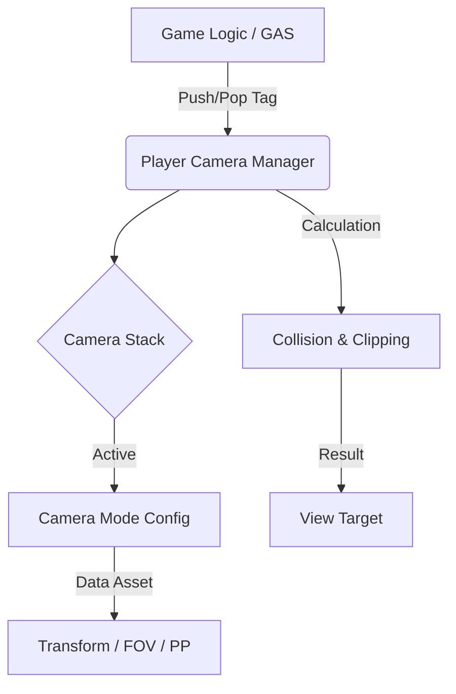

# Enhanced Camera System (ECS)

[](https://www.unrealengine.com/)
[](LICENSE)
[](#technical-architecture)
[](#designer-workflow)

**Enhanced Camera System (ECS)** is a modular, runtime-switchable camera framework for Unreal Engine 5. Designed to meet the demands of high-fidelity productions, ECS decouples complex camera logic from character actors, empowering designers with a robust, data-driven pipeline for managing gameplay perspectives, cinematic transitions, and environmental camera overrides.

---

## 🚀 Technical Design

ECS is designed for the performance and scalability requirements of large-scale projects (Witcher-style open worlds or Cyberpunk-style dense urban environments):

| Feature | Design Implementation |
| :--- | :--- |
| **Decoupled Architecture** | Logic is contained in `UCameraModeConfigBase` assets, keeping character code clean. |
| **Stack-Based Logic** | Native `TArray` stack using `FGameplayTag` for fast, predictable state switching. |
| **Smoothing & Blending** | Built-in lerp/slerp blending with customizable jitter-damping and lag. |

---

## 🏗️ System Overview

The system uses a data-driven stack where the Camera Manager processes the active configuration at the top of the stack.



---

## ✨ Features

- **Push/Pop Stack**: Easily handle temporary states (aiming, cutscenes, interactions) without losing your base camera settings.
- **Occlusion Handling**: Uses `LastCollisionLocation` to prevent camera snapping when objects move between the camera and player.
- **Smoothing**: Optimized positional and rotational lag logic for smooth character tracking at any framerate.
- **Visual Integration**: Interpolated Post-Process and FOV transitions per camera mode.
- **Extensible Logic**: Override `CalculateCamera` (BlueprintNativeEvent) in C++ or Blueprints to add custom behavior like ray-traced avoidance.

---

## ⚡ Performance

| Metric | Detail |
| :--- | :--- |
| **Tick Method**| Directly overrides `UpdateCamera` for maximum efficiency. |
| **Complexity** | O(1) state lookups and stack operations. |

---

## 🛠️ Requirements & Installation

### System Requirements
| Component | Requirement |
| :--- | :--- |
| **Unreal Engine** | 5.3 |
| **Project Type** | C++ or Blueprint |
| **Engine Modules** | `GameplayTags`, `Core`, `Engine` |

### Installation Guide

#### 📥 Option A: Release ZIP (Recommended)
1. Download the latest packaged plugin ZIP.
2. Extract the contents into your project's `Plugins/` directory.
3. Restart the Editor — no project regeneration is required for pre-built binaries.

#### 🛠️ Option B: From Source (GitHub)
1. Clone/Copy the repository to `<YourProject>/Plugins/EnhancedCameraSystem/`.
2. Regenerate project files (Right-click `.uproject` → **Generate Visual Studio project files**).
3. Build the project in your IDE or let the Editor compile on startup.

---

## 🏗️ Core Architecture & Workflow

ECS utilizes a decoupled architecture where the **Camera Manager** handles orchestration and the **Data Assets** define state.

### 1. The Manager
Set your `PlayerCameraManagerClass` in your `GameMode` or `PlayerController` to:
`AEnhancedPlayerCameraManager`

### 3. Production-Ready Config Templates
The plugin includes specialized camera configurations to accelerate development:

| Config Class | Best Use Case | Key Behavior |
| :--- | :--- | :--- |
| **`GenericCameraModeConfig`** | General Gameplay | Standard socket-follow with configurable offsets and lag. |
| **`InputFollowCameraModeConfig`** | Third Person / Orbit | Camera orientation natively follows player input axes. |
| **`InputToDistanceCurveCameraModeConfig`**| Dynamic Zoom / Dolly | Maps player input to camera distance via customizable curves. |

### Technical Reference
| Variable | Type | Description |
| :--- | :--- | :--- |
| `FollowSocketName` | `FName` | The bone or socket the camera tracks. |
| `SocketOffset` | `FVector` | Offset relative to the follow socket. |
| `TargetOffset` | `FVector` | Look-at offset (useful for over-the-shoulder). |
| `bEnableLag` | `bool` | Enables smoothing for position and rotation. |
| `TransitionDuration`| `float` | Time (in seconds) to blend when switching TO this mode. |

> [!NOTE]
> Specialized configs (like `InputToDistanceCurveCameraModeConfig`) use **`FRuntimeFloatCurve`** for high-precision input mapping.

---

## 🔗 Resources & Integration

### 🎮 Sample Project
> [!TIP]
> **[Download Sample Project (UE5.3)](https://drive.google.com/drive/folders/1L0G4GznlmOKkiwyFeq7Und8BddIfQ9yr?usp=sharing)**  
> Includes preconfigured camera modes, workflow examples, and a test character demonstrating runtime switching.

### 🧩 Technical Implementation

#### Blueprint Integration
Drag from `Get Player Camera Manager` → **Cast to AEnhancedPlayerCameraManager** → Use `SetCameraModeByTag` (Global) or `PushCameraMode` (Contextual).

#### C++ State Management
```cpp
// Example: Standardizing a High-Priority State Transition
if (AEnhancedPlayerCameraManager* EnhancedCam = Cast<AEnhancedPlayerCameraManager>(PlayerCameraManager))
{
    // Contextual Push: E.g., Entering Aim-Down-Sights (ADS)
    EnhancedCam->PushCameraMode(ADSConfigAsset, FGameplayTag::RequestGameplayTag("Camera.State.ADS"));
    
    // Safety Fallback: Pop back to previous gameplay state
    // EnhancedCam->PopCameraMode(); 
}
```

---

## 🏢 Studio Integration

### Using with GAS (Gameplay Ability System)
ECS works best when tied to **GameplayTags**. For example:
- **Setup**: Add tags like `Camera.State.Sprint` or `Camera.State.Combat` to your abilities.
- **Logic**: Use ability activation to `PushCameraMode` and expiration to `PopCameraMode`.

### Target Platforms
The system is frame-rate independent (uses `DeltaTime` for all smoothing) and has been tested on **Windows**. Support for other platforms is technically feasible but currently untested.

### Custom Collision
If you need specific occlusion logic (e.g., dense jungle or tight corridors):
1. Extend `GenericCameraModeConfig`.
2. Override `CalculateCamera`.
3. Use `SphereTraceSingleForObjects` to adjust the camera position dynamically.

---

## 🔍 Troubleshooting & Pipeline Tips

### Linker Errors (Unresolved Symbols)
Ensure your module's `.uplugin` and `Build.cs` are synchronized. Linker errors typically indicate a missing dependency on `Core` or `Engine`.
- **Action**: Verify `EnhancedCameraSystem` is added to `PublicDependencyModuleNames`.

### DataAsset Visibility
If custom configs are not appearing: Compile in IDE → Restart Editor → Right-click → **Misc > Data Asset**.

### Advanced Extensibility
For complex logic (e.g., raytraced collision avoidance), extend `CameraModeConfig` in Blueprint and override the `CalculateCamera` (BlueprintNativeEvent).

---

## 🏳️ License & Support
Released under the **MIT License**. Engineered for stability and performance.

> [!NOTE]
> For enterprise-grade support or custom feature requests, please open a GitHub Issue with your UE version and reproduction logs.

© 2024 Shankharaj Datta


