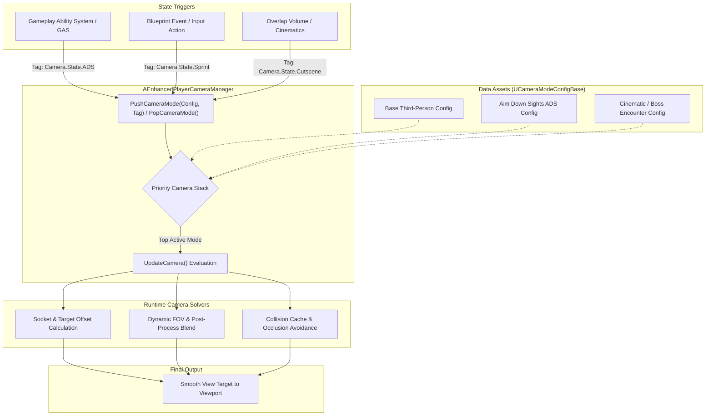

# Enhanced Camera System (ECS) for Unreal Engine 5

[](https://www.unrealengine.com/)
[](README.md)
[](LICENSE)
[](https://www.linkedin.com/in/shankharaj-datta-45921a28a/)
[](#system-overview)
[](#core-architecture--workflow)

**Enhanced Camera System (ECS)** is a modular, high-performance, runtime-switchable camera framework for Unreal Engine 5 (UE 5.3). Designed for AAA productions and dynamic action titles, ECS completely decouples camera behaviors from character blueprints. It empowers designers with a prioritized, data-driven camera stack for cinematic transitions, aiming perspectives (ADS), sprint FOV blends, and environmental occlusion overrides.

> [!TIP]
> **Zero Compilation Required for Blueprint Users**: Pre-compiled Win64 editor binaries (`.dll` + `.modules`) are included. Simply copy the `5.3/EnhancedCameraSystem` folder into your project's `Plugins/` folder!

---

## 🚀 Design Principles

| Pillar | Technical Implementation |
| :--- | :--- |
| **Data-Driven Decoupling** | Camera profiles are defined in lightweight `UCameraModeConfigBase` PrimaryDataAssets — zero hardcoding on the player pawn. |
| **Prioritized Stack Logic** | Push and pop modes using `FCameraStackEntry` with deterministic transition blends, keeping your base exploration camera safe. |
| **Native Anti-Jitter Smoothing** | Built-in positional and rotational lag interpolation, frame-rate independent delta calculations, and occlusion recovery caching. |
| **GameplayTag & GAS Driven** | Seamlessly integrate with the Gameplay Ability System (GAS) — push ADS/Sprint camera modes on ability activation and pop on end. |

---

## 🏛️ System Overview & Architecture

ECS overrides `UpdateCamera` inside `AEnhancedPlayerCameraManager`, processing camera layers in an $O(1)$ priority stack:



---

## ✨ Core Features

- 📚 **Prioritized Push/Pop Stack**: Easily handle temporary states (aiming, sprinting, ladder climbing, dialogues) without losing your base camera settings.
- 🛡️ **Anti-Snapping Occlusion Handling**: Uses `LastCollisionLocation` caching to prevent harsh camera cuts when walls or geometry pass between the camera and character.
- 🎯 **Frame-Rate Independent Smoothing**: Native positional and rotational lag algorithms guarantee smooth character tracking across 30, 60, and 120+ FPS.
- 🎨 **Visual Interpolation**: Smoothly blend Post-Process settings, depth of field, and Field of View (FOV) curves between camera modes.
- 🔧 **Blueprint & C++ Extensibility**: Override `CalculateCamera` (BlueprintNativeEvent) to inject custom math, such as ray-traced sphere sweeps or shoulder swaps.

---

## ⚡ Performance Profile

| Metric | Technical Detail |
| :--- | :--- |
| **Tick Method** | Directly overrides `UpdateCamera` on `APlayerCameraManager` — zero actor tick loops. |
| **Memory Footprint** | Lightweight UObjects and lightweight struct array stack; negligible memory footprint. |
| **Algorithmic Complexity** | $O(1)$ active mode retrieval and tag lookups. |

---

## 🛠️ Installation & Setup

### 1. Installation
1. Copy the inner `5.3/EnhancedCameraSystem` folder into your project's `Plugins/` directory:
   ```text
   YourProject/
   └── Plugins/
       └── EnhancedCameraSystem/
           ├── EnhancedCameraSystem.uplugin
           ├── Binaries/Win64/
           ├── Resources/
           └── Source/
   ```
2. Enable the plugin under **Edit > Plugins > Gameplay > Enhanced Camera System**.

### 2. Player Camera Manager Setup
In your `GameMode` or `PlayerController` Blueprint:
- Set **Player Camera Manager Class** to `AEnhancedPlayerCameraManager`.

---

## 🎮 Core Architecture & Workflow

### Production-Ready Config Templates Included:

| Config Class | Best Use Case | Key Behavior |
| :--- | :--- | :--- |
| **`GenericCameraModeConfig`** | General Gameplay & Exploration | Socket-follow with customizable target offsets and lag smoothing. |
| **`InputFollowCameraModeConfig`** | Third Person Orbit / Free Look | Camera orientation dynamically orbits around input axes. |
| **`InputToDistanceCurveCameraModeConfig`** | Dynamic Zoom / Vehicle / Sprint | Maps player speed or input axis to spring-arm distance via curves (`FRuntimeFloatCurve`). |

### Key Config Parameters:
| Parameter | Type | Purpose |
| :--- | :--- | :--- |
| `FollowSocketName` | `FName` | Bone or socket the camera tracks (e.g. `head`, `camera_root`). |
| `SocketOffset` | `FVector` | Positional offset relative to the follow socket. |
| `TargetOffset` | `FVector` | Look-at target offset (ideal for over-the-shoulder perspectives). |
| `bEnableLag` | `bool` | Toggles positional and rotational smoothing interpolation. |
| `TransitionDuration` | `float` | Duration (in seconds) to blend smoothly WHEN entering this mode. |

---

## 💻 Code & Blueprint Integration

### Blueprint Integration
Drag from `Get Player Camera Manager` → **Cast to AEnhancedPlayerCameraManager**:
- Call **Push Camera Mode** when entering a state (e.g. Aiming / Sprinting).
- Call **Pop Camera Mode** when the state ends.

### C++ State Transition Example
```cpp
#include "EnhancedPlayerCameraManager.h"

// Contextual push: E.g., Entering Aim-Down-Sights (ADS)
if (AEnhancedPlayerCameraManager* EnhancedCam = Cast<AEnhancedPlayerCameraManager>(PlayerCameraManager))
{
    EnhancedCam->PushCameraMode(ADSConfigAsset, FGameplayTag::RequestGameplayTag("Camera.State.ADS"));
    
    // When done:
    // EnhancedCam->PopCameraMode();
}
```

---

## 📥 Sample Project Showcase

A complete sample project demonstrating runtime camera switching, aiming, and sprint blends is available:

👉 **[Download Sample Project (UE 5.3 Google Drive)](https://drive.google.com/drive/folders/1L0G4GznlmOKkiwyFeq7Und8BddIfQ9yr?usp=sharing)**

---

## 📄 License & Attribution

Distributed under the **MIT License**. See [LICENSE](LICENSE) for details.

Created by **[Shankharaj Datta](https://www.linkedin.com/in/shankharaj-datta-45921a28a/)**.
